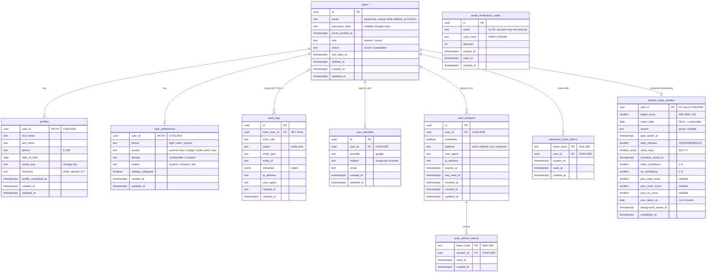

# Database

PostgreSQL is the single database for the web app, the Owner dashboard and the Android/iOS
apps. The rules below (0.00) apply to every migration; the migration tool, the ERD and the core
tables are by 0.01. **Every session that adds a table adds it to the ERD and the table list here.**

Local development uses PostgreSQL 18 (Postgres.app); production version is decided by 5.05
(PostgreSQL 15+ is required).

## Access from Go

- One `pgxpool.Pool` (`internal/platform/database`) is created at startup and passed to
  modules. Pool size: `DATABASE_MAX_CONNS`.
- SQL is hand-written in each module's repository with `$1, $2` parameters. Identifiers are
  never built from user input. No ORM.
- `GET /ready` pings the database; the API starts even when PostgreSQL is down and becomes
  ready once it answers.

## Migrations

- Location: `api/migrations/`. File names: `YYYYMMDDHHMMSS_snake_case_name.up.sql` and
  `.down.sql`. Timestamps (not 0001, 0002…) so sessions working in parallel never collide.
- Tool: **golang-migrate** (v4, pgx/v5 driver), used as a library. `api/migrations/embed.go`
  compiles the SQL files into `api/cmd/migrate`; `internal/platform/migrate` wraps it and
  validates file names. Applied versions are in `schema_migrations`; an advisory lock stops two
  runs from interleaving.
- Commands (from the repo root, database from `DATABASE_URL`):

  | Command | Does |
  | --- | --- |
  | `make migrate-up` | apply every pending migration (`go run ./cmd/migrate up`) |
  | `make migrate-down [n=1]` | revert the last n migrations |
  | `make migrate-status` | applied version, latest version, pending list, dirty flag |
  | `make migrate-create name=…` | new empty `.up.sql`/`.down.sql` pair with a UTC timestamp |
  | `go run ./cmd/migrate force <v>` | after repairing a failed ("dirty") migration by hand; `-1` = none |

- The API server **does not migrate on start-up**. Migrations are a separate step before the
  new binary starts (locally `make migrate-up`; in deploys a pipeline step, 5.05).
- **Re-running is safe**: the tool records applied versions, so `up` on an up-to-date database
  does nothing and never touches data.
- An applied migration is never edited — fix forward with a new one.
- `down` must exactly revert `up`; an integration test runs up → down → up on a disposable
  database (`TEST_DATABASE_URL`, never the development database).
- Keep a migration atomic: wrap dependent statements in `BEGIN; … COMMIT;`.
  `CREATE INDEX CONCURRENTLY` cannot run in a transaction and goes in its own migration.
- **Expand → migrate → contract**: add the new column/table first, backfill, switch the code,
  drop the old column in a later release. Old mobile app versions keep working meanwhile.
- Reference rows every environment needs (roles, SAT domains, plans) are inserted with
  `ON CONFLICT DO NOTHING`. Demo/sample data never goes into migrations; it lives in a
  development-only seed command.

## Naming

- Tables: plural `snake_case` (`exam_attempts`, `question_versions`); join tables name both
  sides (`plan_features`).
- Columns: `snake_case`; foreign keys `<entity>_id`; booleans `is_…`/`has_…`; timestamps `…_at`.
- Primary keys: `id UUID PRIMARY KEY DEFAULT gen_random_uuid()`. Lookup tables may use a
  natural text key (`code`).
- Indexes `<table>_<columns>_idx`, unique indexes `<table>_<columns>_key`.
- Enum-like values: lowercase `snake_case` text with a `CHECK` constraint (easier to extend than
  PostgreSQL enums).

## Integrity

- Every relationship has a foreign key. `ON DELETE CASCADE` for data owned by a user (attempts,
  bookmarks, mistakes); `RESTRICT` or `SET NULL` where history must survive (a retired question
  version stays referenced by old exam responses).
- Invariants are constraints, not just application checks: `NOT NULL`, `UNIQUE`, `CHECK`, and
  partial unique indexes for "only one active …" (one active study plan, one in-progress exam
  attempt per exam).
- Every mutable table has `created_at` and `updated_at TIMESTAMPTZ NOT NULL DEFAULT now()`;
  `updated_at` is maintained by the shared `set_updated_at()` trigger function (0.01):
  `CREATE TRIGGER <table>_set_updated_at BEFORE UPDATE ON <table> FOR EACH ROW EXECUTE FUNCTION set_updated_at();` `updated_at` also enables incremental
  mobile sync later (`?updated_since=`).
- Soft delete (`deleted_at`) only where history or recovery matters (users pending deletion,
  published content). Unique constraints on soft-deleted tables are partial
  (`WHERE deleted_at IS NULL`).
- Content that learners answer against is versioned (`question_versions`); attempts reference
  the exact version they saw.
- Audit: `audit_logs` is append-only — a trigger rejects UPDATE, DELETE and TRUNCATE — and
  records actor, action, entity, metadata and time for every important Owner action.

## Transactions

- A business operation that writes more than one row runs in one transaction inside the owning
  module's repository/service (`pool.Begin(ctx)` + deferred `Rollback`, `Commit` at the end).
  Handlers never manage transactions.
- Counters and limits use one conditional `UPDATE … RETURNING`, not read-modify-write.
- Retries must be safe: submissions, webhooks and job results use a unique key with
  `ON CONFLICT` (idempotency). Exam submit is idempotent (3.08).

## ERD

Tables that exist now. Owning sessions add theirs here (and to the table list below).

## Tables

### `users` — 0.01 (used by 1.01, 1.02)

Sign-in identity of learners and the Owner. Names live in `profiles`, appearance in
`user_preferences`; sessions, codes and Google identities are 1.01's tables referencing `users(id)`.

| Column | Type | Notes |
| --- | --- | --- |
| `id` | UUID PK | `gen_random_uuid()` |
| `email` | TEXT NOT NULL | Stored normalised: `CHECK (email = lower(btrim(email)))`, 3–254 chars, contains `@`. The API normalises before writing (`auth.NormalizeEmail`). |
| `password_hash` | TEXT NULL | Argon2id PHC string; NULL for Google-only accounts |
| `email_verified_at` | TIMESTAMPTZ NULL | |
| `role` | TEXT NOT NULL `'learner'` | `learner`, `owner`. Owner accounts are seeded/created by an admin process (1.02), never by sign-up. 1.02 extends the CHECK if staff roles are added. |
| `status` | TEXT NOT NULL `'active'` | `active`, `suspended` (4.03) |
| `last_login_at` | TIMESTAMPTZ NULL | |
| `deleted_at` | TIMESTAMPTZ NULL | Account deletion (2.10); the email becomes free |
| `created_at`, `updated_at` | TIMESTAMPTZ | trigger-maintained `updated_at` |

Indexes: `users_email_key` UNIQUE `(email) WHERE deleted_at IS NULL` — look users up with
`WHERE email = $1 AND deleted_at IS NULL`; `users_role_created_at_idx (role, created_at DESC)
WHERE deleted_at IS NULL` for learner lists and counts.

### `profiles` — 0.01 (filled by 1.01, 2.01, 2.10)

One row per user, created with `INSERT … ON CONFLICT (user_id) DO UPDATE` by whichever session
first has data (Google sign-up prefill, or Profile Setup). A missing row means "not set up yet".

| Column | Type | Notes |
| --- | --- | --- |
| `user_id` | UUID PK → `users` CASCADE | |
| `first_name`, `last_name` | TEXT NULL | 1–100 chars after trim |
| `phone` | TEXT NULL | E.164 (`+998901234567`) |
| `date_of_birth` | DATE NULL | ≥ 1900-01-01; the API requires age ≥ 13 (2.01) |
| `avatar_key` | TEXT NULL | `avatars/<user-id>/<32 hex>.jpg` (2.01); NULL = default avatar |
| `timezone` | TEXT NOT NULL `'UTC'` | IANA name; the API validates it (`time.LoadLocation`) |
| `profile_completed_at` | TIMESTAMPTZ NULL | Set once when Profile Setup is done → onboarding; the setup upsert has `WHERE profile_completed_at IS NULL`, so a finished profile is never overwritten by it |
| `created_at`, `updated_at` | TIMESTAMPTZ | |

### `user_preferences` — 0.01 (read/written by 2.11; Owner appearance by 4.01)

Appearance that follows the account across devices. Values are the web theme attributes from
0.02. A missing row means all defaults (neutral Light). Wallpaper (2.11) and notification
settings (2.11/3.14) are added by those sessions as new columns in their own migrations.

| Column | Type | Default | Allowed |
| --- | --- | --- | --- |
| `user_id` | UUID PK → `users` CASCADE | | |
| `theme` | TEXT | `light` | `light`, `dark`, `system` |
| `accent` | TEXT | `neutral` | `neutral`, `blue`, `indigo`, `violet`, `teal`, `rose` |
| `density` | TEXT | `comfortable` | `comfortable`, `compact` |
| `motion` | TEXT | `system` | `system`, `reduced`, `full` |
| `sidebar_collapsed` | BOOLEAN | `false` | |
| `created_at`, `updated_at` | TIMESTAMPTZ | | |

### `audit_logs` — 0.01 (written by the 1.02 helper, read by 4.07 and 4.02)

| Column | Type | Notes |
| --- | --- | --- |
| `id` | UUID PK | |
| `actor_user_id` | UUID NULL → `users` SET NULL | NULL for system actions or after the actor is deleted |
| `actor_role` | TEXT NULL | Role at the time of the action (`owner`, …) |
| `action` | TEXT NOT NULL | `<entity>.<verb>` lowercase, e.g. `question.publish`, `learner.suspend` |
| `entity_type` | TEXT NULL | lowercase snake_case, e.g. `question` |
| `entity_id` | TEXT NULL | Text so natural keys fit; ≤ 128 chars |
| `metadata` | JSONB NOT NULL `{}` | Must be an object. Never secrets, tokens or passwords |
| `ip_address` | INET NULL | |
| `user_agent` | TEXT NULL | ≤ 512 chars (truncate before insert) |
| `request_id` | TEXT NULL | `X-Request-ID` of the request |
| `created_at` | TIMESTAMPTZ | |

Append-only: trigger `audit_logs_prevent_change` raises SQLSTATE `42501` on UPDATE, DELETE and
TRUNCATE. The only allowed UPDATE is the foreign key setting `actor_user_id` to NULL when a user
row is hard-deleted. A future retention purge (if decided) needs its own migration.
Indexes: `created_at DESC`; `(actor_user_id, created_at DESC)`;
`(entity_type, entity_id, created_at DESC)`; `(action, created_at DESC)`.

### Auth tables — 1.01

Owned by `api/internal/auth` (`repository.go`). Secrets are never stored in plain form: codes as
HMAC-SHA256 bound to the email, refresh and reset tokens as SHA-256 of 256-bit random values.

| Table | Purpose | Key rules |
| --- | --- | --- |
| `user_identities` | Google sign-in link | Unique `(provider, subject)`; matched by Google `sub`, not email. `provider IN ('google')`. |
| `email_verification_codes` | Sign-up / sign-in codes | Keyed by email (no FK). Index `(email, created_at DESC)` serves "newest code" (locked `FOR UPDATE` on verify) and the resend cooldown / daily cap. `attempts ≥ 0`, `expires_at > created_at`. |
| `auth_sessions` | One row per sign-in on a device | `platform IN (web, android, ios, unknown)`, `user_agent ≤ 512`. Revoked by logout, password reset (all of the user's) and refresh-token reuse. Partial index on `user_id WHERE revoked_at IS NULL`. |
| `auth_refresh_tokens` | Rotating refresh tokens of a session | PK `token_hash`; locked `FOR UPDATE` during refresh. A used token stays, so its reuse is detected. |
| `password_reset_tokens` | Password reset links | PK `token_hash`, single use, 1 h. A new request marks the user's earlier unused tokens used. |

Expired codes, used tokens and old revoked sessions are not purged yet; a cleanup job is a
later decision (5.05).

### `learner_study_profiles` — 2.02 (read by 2.04, 2.05; edited by 2.11)

Onboarding answers (PRD §8), owned by `api/internal/onboarding` (`repository.go`). One row per
learner, created by the first saved step (upsert). NULL is "not answered", never a default.

| Column | Type | Notes |
| --- | --- | --- |
| `user_id` | UUID PK | FK `users`, `ON DELETE CASCADE` |
| `target_score` | SMALLINT NULL | 400–1600, multiple of 10; NOT NULL once `goal_saved_at` is set |
| `exam_date` | DATE NULL | NULL with `goal_saved_at` set = the learner has not decided |
| `reason` | TEXT NULL | `college_admission`, `scholarship`, `improve_score`, `practice`, `other` |
| `daily_minutes` | SMALLINT NULL | 15, 30, 45, 60, 90, 120 (= 2+ hours) |
| `study_days` | SMALLINT[] NULL | ISO weekdays 1 (Mon) … 7 (Sun), 1–7 items, sorted by the app |
| `math_confidence`, `rw_confidence` | SMALLINT NULL | 1–5 |
| `prev_total_score` | SMALLINT NULL | Earlier official SAT result, 400–1600 ×10 |
| `prev_math_score`, `prev_rw_score` | SMALLINT NULL | Both or neither, 200–800 ×10, sum = total |
| `prev_taken_on` | DATE NULL | First day of the (approximate) month, from 2016-03; needs a total |
| `goal_saved_at`, `schedule_saved_at`, `background_saved_at` | TIMESTAMPTZ NULL | When each step was last saved; the step's required columns are NOT NULL once set (CHECK) |
| `completed_at` | TIMESTAMPTZ NULL | Onboarding finished; requires all three `*_saved_at` (CHECK). Set once (`COALESCE`) |
| `created_at`, `updated_at` | TIMESTAMPTZ | `set_updated_at()` trigger |

Every app rule is also a CHECK constraint, so writes from other sessions cannot store values the
API would reject.

## Migration log

| Version | File | Session |
| --- | --- | --- |
| 20261012090000 | `create_set_updated_at_function` | 0.01 |
| 20261012090100 | `create_users` | 0.01 |
| 20261012090200 | `create_profiles` | 0.01 |
| 20261012090300 | `create_user_preferences` | 0.01 |
| 20261012090400 | `create_audit_logs` | 0.01 |
| 20261012120000 | `create_user_identities` | 1.01 |
| 20261012120100 | `create_email_verification_codes` | 1.01 |
| 20261012120200 | `create_auth_sessions` (+ `auth_refresh_tokens`) | 1.01 |
| 20261012120300 | `create_password_reset_tokens` | 1.01 |
| 20261012150000 | `create_learner_study_profiles` | 2.02 |

## Planned entities (PRD §3)

Study Plans, Study Plan Tasks, Curriculum Domains, Topics, Lessons, Questions,
Question Versions, Practice Attempts, Mock Exams, Exam Modules, Exam Attempts, Exam Responses,
Bookmarks, Mistake Records, AI Conversations, Subscriptions, Payments, Notifications. Each is
created by the session that owns it (see CLAUDE.md), which also updates the ERD above.
(Learner Goals: `learner_study_profiles`, 2.02.)
